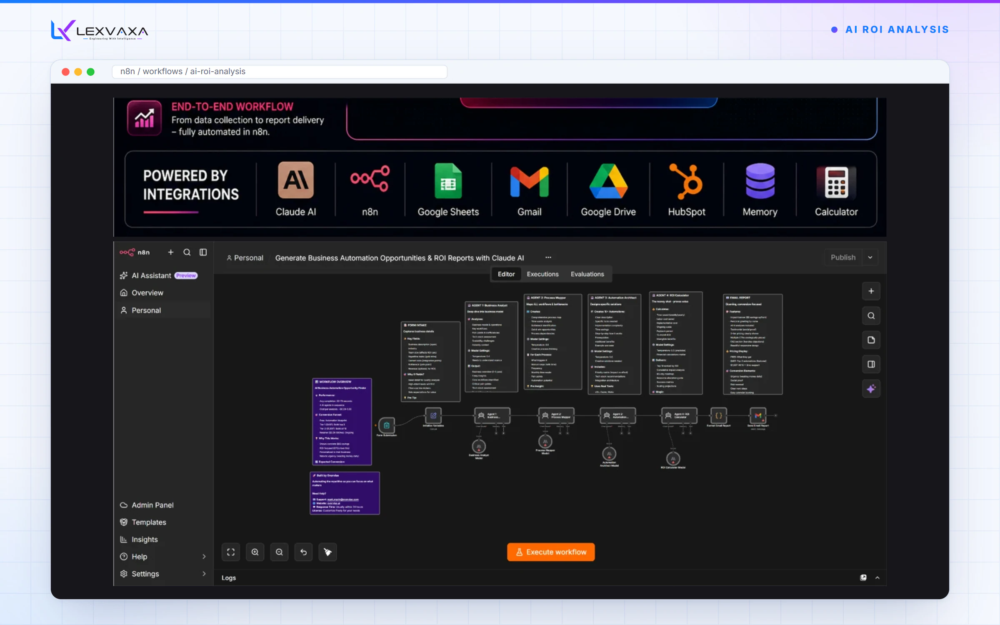

# AI Business Automation & ROI Analysis with Claude

**An n8n and Claude AI system that finds automation opportunities in a business, calculates their ROI and delivers the report automatically.**

       

## Overview

Businesses needed a faster way to find automation opportunities and measure their value. Lexvaxa built an AI business automation system using n8n and Claude AI. It collects business data, runs an AI opportunity analysis, calculates ROI and value for each opportunity, generates the report and handles follow-up actions through CRM and email, end to end. Screens shown use sample data, so no client records are exposed.

## The challenge

Finding and pricing automation opportunities by hand took long workshops and spreadsheets.

## The solution

An n8n workflow with Claude AI agents, memory and a calculator tool, connected to Google Sheets, Google Drive, Gmail and HubSpot.

## Key features

- Automated business data collection
- AI opportunity analysis
- ROI and value assessment
- Automated reports
- CRM and email follow-up

## Results

- High-impact automation opportunities are found faster and backed by numbers

## Tech stack

n8n · Claude API · Google Sheets · Google Drive · Gmail · HubSpot

## Privacy

Client names and records are confidential. Every screen in this repository uses sample data, and source code that belongs to the client is not published.

## Links

- Case study on Lexvaxa: https://lexvaxa.com/work/ai-roi-analysis-claude
- Built by **Ch Muhammad Samiullah** ([GitHub](https://github.com/samiullah156-creator)) at [Lexvaxa](https://lexvaxa.com)
